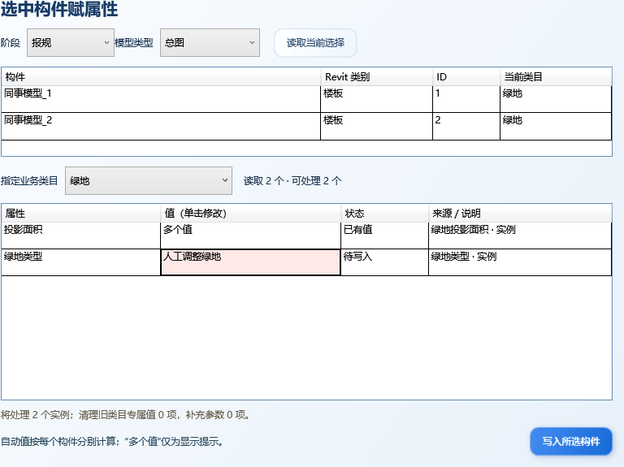

# 0.4.3 选中构件赋属性

“H-IFC V1 → 模型属性管理”中的“准备映射参数”升级为“选中构件赋属性”。这是独立的非模态窗口，可以在窗口打开时继续操作 Revit。

## 使用

1. 在 Revit 中单选、框选或多选待处理构件，点击“选中构件赋属性”。
2. 阶段和模型类型沿用当前项目的确认记录；首次使用时先选择，再点“读取当前选择”。
3. 在“指定业务类目”中选择用途。列表按所选实体支持的映射筛选，不依赖同事起的名称自动决定用途。已有一致类目的构件直接显示属性。
4. 程序为各构件分别计算可确定的模型值，保留已有值。单击属性的值即可编辑；多选值不同时显示“多个值”，未明确修改时保持各自原值或各自的计算建议。
5. 点击“写入所选构件”。程序补齐缺参数、写值并回读验证，随后自动打开或刷新完整的模型检查窗口，重新检查整个项目。

在 Revit 中重新选择后，点击“读取当前选择”更新处理对象。窗口中的目标清单固定到本次读取，不会因外部选择变化而把待写入修改转给另一批构件。

红色表示手动修改待写入；橙色表示该属性已经手工写入并回读。已有值支持再次修改。切换类目时显示旧类目专属值的清理数量，实际清理与新值写入在同一事务组完成；共用值和其他实例所用的类型值保留。未知旧类目不猜测其专属字段。

类型来源仅查看，避免改动未选中的同类型实例。新增共享参数定义仍按 Revit 类别绑定，业务值仅写入本次选择的实例。停车属性需要面积（Area）载体；停车族、链接或不支持的对象会显示未纳入原因。只有道路宽度要求手填的现有约定继续适用。

## 验证与安装

- 核心 85 项、实际 WPF 界面 63 项、Python 21 项测试通过。界面测试包含已有值的单击编辑、批量值隔离、过期拦截和窄窗口布局。
- Revit 2020 实机 17 项检查通过：人为错误类目修正、批量写入、每个实例分别自动计算、未选中实例与共享类型保护、写入橙色、切类目清旧值、道路宽度再次编辑、每次写入后全面检查、停车载体限制、保存关闭重开及阶段/类型记忆。
- 实机使用独立模型副本，刻意将两个楼板改为测试类目再改回另一类，用于验证写入与清理；该副本不是正式业务成果。原始输入文件 SHA256 保持 `239caedce89d92a0bc00dc089a2f2eabe7eefe133ee39b8690da7610c3376eac`。
- 实机回执：`V1/validation/selection-native-20261016-230203-401e3844/selection-host-result.json`；最终文件核验与临时加载项清理：同目录 `final-verification.json`。
- 0.4.3 已安装并由实机测试宿主实际加载。安装目录为 `C:/Users/2899/AppData/Roaming/Autodesk/Revit/Addins/2020/Hifc.V1`，插件 DLL SHA256 为 `544e6883590e06eb300b4fa44d9403f61c7b2d7a9b9d76cd61ba16bff2020ddf`。测试宿主已正常退出，临时验收加载项已移除。

