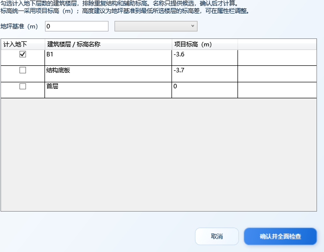

# 0.4.4 报规地下区域与指标

本版沿用主管理窗口和“选中构件赋属性”两个入口。独立地下建筑、地上地下混合建筑仍选“单体建筑”；施工图专用规则继续保持待建立状态。

## 区域模型与载体

| 业务内容 | Revit 载体 | IFC 实体 |
|---|---|---|
| 人防区域、消防分区、停车场、停车位 | 面积（Area） | IfcSpace |
| 地下建筑区域 | 楼板 | IfcSlab |
| 地下楼层 | 标高（Level） | IfcBuildingStorey |
| 地下建筑层数、高度及地坪标高 | 项目信息 | IfcBuilding |

这四类区域接入总图和单体范围的检查与人工分类。新增区域按实际适用，不能因为参考配置出现某个属性集就要求每个项目必须包含该区域。仅道路宽度继续要求人工填写，不增加新的强制手填标红项。

有效 Area 的实际面积转换为平方米，名称与所属楼层取当前模型；已有值保留，可直接修改。面积方案、名称和已有专用参数提供分类证据，停车场不会直接被识别为停车位。未放置、未封闭和零面积对象报告模型问题。

IfcSpace 也可能来自房间，实体类型本身不能决定业务用途。本版这四类报规区域使用 Area；其他载体显示核对原因，不强制转成空间。地下建筑区域保留楼板载体。

## 地下指标操作

1. 在主管理窗口确认“报规”和模型类型。
2. 点击“地下楼层 / 基准”，勾选计入地下的建筑楼层，排除重复结构和辅助标高；确认地坪基准，单位为**项目标高 m**。也可从下拉选择标高复制基准后调整。
3. 点击“确认并全面检查”。空的地下层数、高度与地坪标高获得建议；在右侧属性中核对、修改。
4. 点击“4 写入 Revit”，回读并全面复检，再保存 RVT。

地下层数按人工确认的楼层计算。高度建议为地坪基准至最低所选楼层的标高差，可以按实际地下建筑高度修改。名称仅提供待确认候选，不按负标高直接计数，也不自动决定半地下室是否计入。

确认记录按模型暂存。每次检查重新读取楼层，已选楼层被删除、替换或同标高重复时报告原因，停止生成这组指标建议。已有值保留，与本轮建议不同的值在属性来源中说明，不据此阻断其他区域处理。

## 导出修正

- 冻结的原始工规契约保持不变；运行时纠正地下建筑层数的 Integerl 拼写，IFC 中生成 IfcInteger。
- 导出配置仅启用本次对象适用的属性集。Revit 2020 对 Real、Boolean 的同名回退可能使停车位额外生成停车场属性集。本版在桥接取值后、导出事务内临时隔离相应项目参数绑定，导出后回滚并回读；无法隔离的族或内置来源明确报告。
- 建筑、楼层采用原生空间 GUID，Area 沿用原生导出标识，核验按标识检查实体和属性集归属。
- Area 类型面积参数、Length 类型地下高度在写入、回读和导出时处理平方米、米与内部单位的换算。
- 每份 IFC 只调用一次原生 Document.Export，不后处理 IFC。连续三次导出后，所选与未选对象的来源值均核对恢复。

## 验证范围

核心 **97** 项、独立实际 WPF 窗口 **67** 项、Python **24** 项通过。WPF 检查包括确认记录恢复、基准编辑和楼层名称列的实际布局，不代表在 Revit 内完成真实鼠标端到端操作。

Revit 2020 中从建筑样板建立受控地下模型，再复制后验证；**31** 项宿主检查通过。模型有两个地下建筑楼层、一个不计入的结构标高、五个 Area 和一块建筑区域楼板。楼层项目标高均为正值，仍按人工确认生成地下层数 2、高度建议 7.2 m；人工改为 7.5 m 后保留并报告差异。带单位参数的写入、保存重开和导出均已验证。

| 原生导出范围 | IfcSpace | IfcSlab | 核验属性 | schema 错误 |
|---|---:|---:|---:|---:|
| 地下区域混合模型与建筑汇总 | 5 | 1 | 59 / 59 | 0 |
| 仅停车位 Area | 1 | 0 | 10 / 10 | 0 |
| 仅停车场 Area | 1 | 0 | 7 / 7 | 0 |

独立几何核验确认五个空间的投影面积分别为 100、110、120、200、40 m²，且归属正确的 B1/B2 楼层。读取核验前后 IFC 哈希一致。

本地回执：`V1/validation/underground-native-20261019-123055-c6ddda53/` 下的 `underground-host-result.json`、三个 `*-audit.json`、`geometry-audit.json`。运行目录中的模型、DLL 与临时产物不纳入源码同步。

本轮覆盖受控模型中的新增功能，尚未取得客户真实地下项目的正式 HIFC 平台验收回执。专项交接文档中的地下性质枚举、新增阻断规则、施工图结构属性与编号建议没有作为本轮需求执行。
