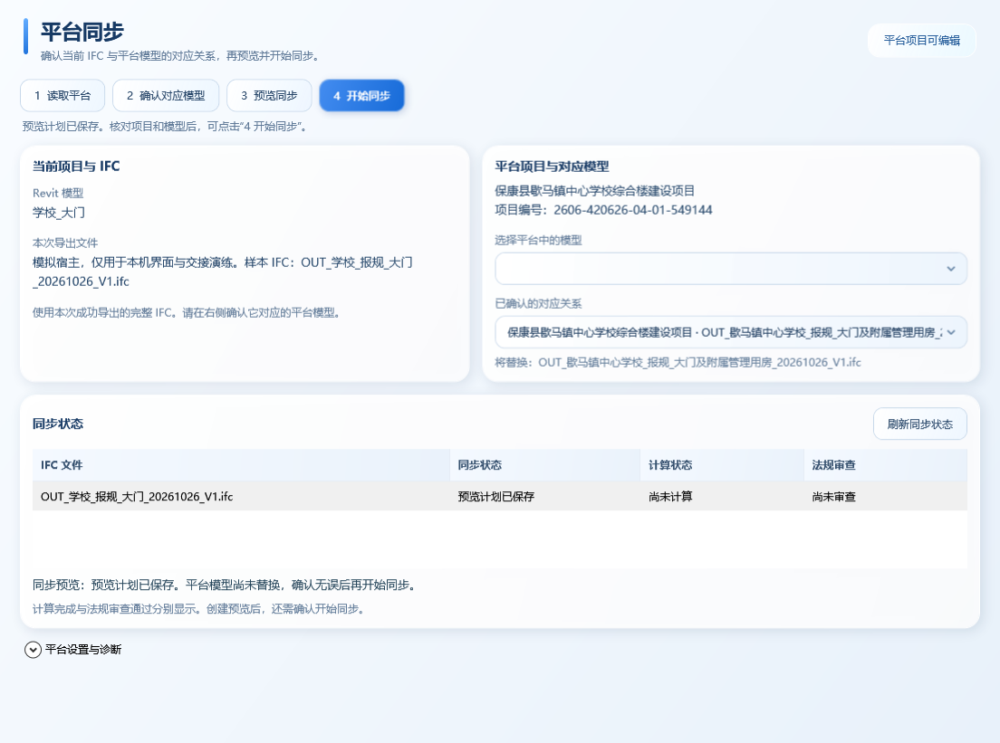

# 平台同步界面统一 · 2026-10-26

本轮为候选界面更新，已获用户确认。正式安装仍为 0.4.19，未安装候选、未上传真实平台、未改客户 RVT。

## 界面结果

同步窗口直接复用现有 `LiquidGlassTheme`：浅蓝背景、深蓝标题、圆角卡片、统一高度的按钮与下拉、同一表格样式。

- 顶部四步操作：读取平台、确认对应模型、预览同步、开始同步。
- 中部并列当前 RVT/IFC 与平台项目/对应模型；长名称可通过换行及提示查看。
- 下方展示 IFC 文件名、同步状态、计算状态和法规审查；内部任务 ID 移入详情。
- 技术路径和诊断位于底部折叠区。有效配置重开默认收起，缺失或失效时展开并解释。
- 已知审核中状态会就地显示原因并禁用开始按钮；后台新鲜身份与可编辑检查继续保留。

下图是实际 WPF 窗口的演练数据截图，并非真实平台可编辑状态证明。

## 实现和验证

布局独立到 `src/Hifc.Revit/PlatformSync/PlatformSyncWindow.Layout.cs`，与原窗口行为部分共用 partial 类；独立预览项目链接同一布局及主题文件。DTO 增加审核状态和任务中的原 IFC 文件名，仅用于展示，同步引擎不变。

新增四项行为回归先失败后通过：有效配置折叠、缺失/失效配置展开解释、已知不可编辑禁用、文件名优先与内部 ID 隐藏。另保留多状态截图核验；未增加逐一锁定颜色数值的样式测试。

- WPF 全集 **149/149** 项通过，失败 0。
- 正式插件项目与独立预览项目 Release 编译通过，0 警告、0 错误。
- 实际独立 WPF 窗口调用真实 Node CLI，通过本地 fixture 的读取、绑定、冻结及 PLANNED；删除、上传、提交计数均为 0。
- 独立演练原样本缺少 IFC 项目记录，先复现交接校验阻断后补齐，未放宽生产校验。
- 检查未配置、已预览、审核中、运行中、失败、详情、940 像素宽窗口与 150% 布局缩放的截图。150% 使用 WPF LayoutTransform 和 144 DPI 渲染，不冒充真实 Windows 跨屏 DPI 验收。
- 正式安装 DLL 与本轮开发前哈希一致。

验证索引：[platform-sync-ui-20261026.json](../validation/platform-sync-ui-20261026.json)。本机完整截图与日志在 `V1/validation/ui-style-final/`，独立演练在 `V1/validation/sync-demo-style-green/`。运行记录不整体纳入 Git。

真实上传、FRAG 转换与平台计算仍待可编辑项目验收，见 [同步专项交接](HANDOFF-platform-sync-20261026.md)。
