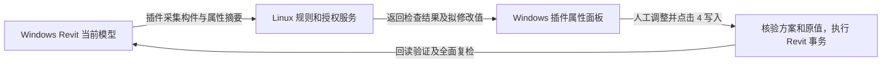

# HIFC Local / Web 内网版设计依据

日期：2026-10-16，北京时间。状态：网络版讨论归档与后续开发依据；已纳入主会话评估和本地模型写入说明，尚未实现或部署网络版。

## 1. 已确认的产品要求

- 产品名为 `HIFC-版本号-Local` 与 `HIFC-版本号-Web`，后缀区分版本。下一次功能发布计划使用 `0.5.0`，`0.4.2` 保留为历史恢复基线；本次归档从已提交的 `0.4.3` 主线建立分支。
- Local 自用，完整规则在本机；Web 给企业内部成员使用，完整映射、案例与判断逻辑留在 zetta-pc。
- 用户在当前 Windows 使用 Revit 和浏览器；Linux 负责服务运行，日常管理不需要到 Linux 电脑前操作。
- 全部业务访问通过局域网。当前阶段不接企业微信、短信平台或公网登录服务。
- 普通用户注册界面只有“手机号、真实姓名”两项。姓名和号码是内部登记资料，不宣称完成了手机号归属验证或实名认证。
- 普通账号首次注册后默认有效 168 小时。统一使用“有效 / 已到期”，没有试用身份、“试用中”文案或停用开关。
- 只有用户本人是管理员，其余注册者都是普通用户。用户通过企微等既有方式联系管理员申请延期，产品第一阶段不另建申请审批流。
- 管理员在 Windows 浏览器按自定义天数或指定日期延期。未到期时从原到期时刻增加天数；已到期时从操作时刻增加天数。指定日期有效至北京时间该日结束。
- 同一手机号、重启、重装、换电脑均不重新计算首次注册的 168 小时。
- 保留四步模型流程、全面扫描、自动值、人工修正、分类清理、写入回读、事务回滚和模型暂存。当前仅道路宽度有手填标红要求，不扩大为其他字段强制手填。
- 只管理模型和属性，不加入材质、贴图、渲染资源功能。
- 本轮交付为文档整理及独立 `hifc-web` 分支归档；本次上传请求不等于执行程序改造、服务安装或变更整个仓库的可见性。

## 2. 计划编制时的环境快照

下表来自同日计划编制的只读调查。文档归档没有重跑 Linux 安装检查或程序测试；资源、端口和工具版本须在后续实施前刷新。GitHub 仓库可见性在本次归档准备时再次查得为 public，完整文档推送前须确认发布范围。

| 项目 | 2026-10-16 核实结果 |
|---|---|
| Windows | `DESKTOP-7JBS9KV`；主要 IPv4 `192.168.218.195/24`；已发现 .NET SDK `7.0.400`；Revit 2020 API 文件存在 |
| SSH | `ssh -o BatchMode=yes zetta-pc "id -un; hostname"` 返回 `zetta`、`pc`，退出码 0 |
| Linux | `192.168.6.45/23`，Ubuntu 24.04.4 LTS，x86_64，KVM 虚拟机 |
| 计算资源 | 8 个逻辑处理器，内存约 31.3 GiB；只作当前容量快照，不代表并发性能已验证 |
| 存储 | 系统卷约 195.3 GiB、空闲 117.6 GiB；第二卷约 983.2 GiB、空闲 885.6 GiB |
| 第二卷现挂载点 | `/media/zetta/55c3d58e-22b5-4ac9-80d7-435081fb7a10`，其开机挂载可靠性尚未验证 |
| 通信路径 | SSH 在 Windows 与 Linux 间可达，Linux 确认 SSH 来源 `192.168.218.195`；两台机器属于不同子网，不能仅按同网段假设配置访问规则 |
| Docker / Compose | SSH 登录环境的 PATH 中均未找到；第一阶段必须安装官方 Docker Engine 与 Compose 插件 |
| Linux .NET | SSH 登录环境的 PATH 中未找到；采用容器运行，不要求 Linux 宿主安装 .NET SDK/运行时 |
| 管理权限 | `sudo -n true` 返回需要密码。普通 SSH 连通不等于已经具备无人值守安装权限；安装时由用户在 Windows SSH 终端完成一次管理员授权 |
| 服务器时钟 | `Asia/Shanghai`，NTP 已同步 |
| 已占用端口 | 22、3000、3080、3457、8787、9749、3389、3390 等；443 另有 Tailscale 地址监听。保持既有服务及其配置 |
| 建议新增入口 | `192.168.6.45:8443`、`:9443` 在这次 TCP 监听快照中未占用；执行前再次检查 |
| 调查时源码 | `main`，HEAD `ecc768b491d38b60d9785c06f3bbd12f0237ba67`，源码 `V1/`，版本 0.4.2；调查前工作树干净 |
| 当前远端 | GitHub 元数据确认 `ArchitectureWorld/BIM-baogui` 为 **public**，默认分支 `main`；必须先处理发布可见性 |

SSH 有一次客户端关闭阶段的 `IO is still pending on closed socket` 诊断；身份及调查 JSON 完整返回且退出码为 0，不把这条关闭诊断当作身份核实失败，也不宣称所有网络服务已经验证。

现有 85 项核心、51 项 WPF、16 项 Python 及三个 RVT 的记录来自 `V1/validation/0.4.2-validation.json`。这是读取到的历史证据，本轮没有重新运行这些程序测试。

计划编制过程中工作区由旧 `work/hifc-v1-0.3.2` 归并到 `D:\18_建模项目\湖北BIM云平台`，HEAD仍相同。本文和计划采用归并后的根目录；其他正在进行的脚本修改不属于本轮计划编辑，不回退也不纳入本轮交付。

文档归档期间主会话另行提交了 `cb34b20a80c172c5c24982e8a58be44c01464a4f`（0.4.3，选中构件属性编辑与Area导出修正）。`hifc-web`以该已提交版本为父提交，只增加本目录文档；旧环境JSON保持原始调查记录，不将其伪装成0.4.3的运行验证。

## 3. 明确的安装清单

| 软件 / 能力 | zetta-pc Linux | 当前 Windows | 处理决定 |
|---|---|---|---|
| Docker Engine | **需要新装** | 不需要 | Ubuntu 官方 Docker 仓库，安装 CE、CLI、containerd、Buildx、Compose 插件 |
| Docker Desktop | 不需要 | 不需要 | 不作为本方案依赖 |
| .NET SDK 10.0.402 | SDK 容器中提供 | **需要在用户独立目录安装** | Windows 现有 SDK 7 不覆盖；项目脚本显式调用新 SDK |
| ASP.NET Core 10 | 运行时容器中提供 | 不需要单独装 | Linux 宿主不另装 .NET |
| PostgreSQL 17 | **需要，以容器部署** | 不需要 | 数据库无宿主公开端口 |
| Caddy 2 | **需要，以容器部署** | 不需要 | HTTPS、业务入口、管理员运维入口 |
| Portainer CE | **内部发包前部署为容器** | 浏览器访问即可 | 仅管理员使用；最小流程先运行HIFC、PostgreSQL、Caddy，运维面板随后接入 |
| HIFC 服务端 | **需要，以容器部署** | 浏览器使用后台 | 一个 ASP.NET Core 进程提供 API 与 Razor Pages 后台 |
| 内网 HTTPS 根证书 | Caddy 私有 CA 数据卷 | **需要导入当前用户信任库** | 安装前显示并核对 SHA-256 指纹；不得绕过证书校验 |
| Revit 2020 / .NET Framework 4.8 | 不安装 | 沿用现有环境 | Revit API、WPF、几何读取、模型事务始终留在 Windows |
| 手机短信 / 微信 / 企微应用 | 不需要 | 不需要 | 内部登记不依赖第三方平台 |

Microsoft 官方发布元数据本轮显示 .NET 10 为 LTS，支持至 2028-11-14；.NET 8 支持至 2026-11-10，故新服务选 .NET 10。容器版本在发布锁文件中锁定 digest，不使用浮动的 `latest` 发布。

## 4. 部署结构和管理入口

```text
当前 Windows / 普通同事 Windows
  Revit 插件 Web ───────────────┐
  Windows 浏览器 /admin ────────┼─ HTTPS 192.168.6.45:8443
                               │      Caddy → HIFC API + 管理后台
                               │                   ├─ 私有规则目录
                               │                   └─ PostgreSQL（容器网络）
  本机管理员浏览器 ─────────────┴─ HTTPS 192.168.6.45:9443
                                      Caddy → Portainer（容器网络）
```

- 业务后台：`https://192.168.6.45:8443/admin`；插件服务基址为同一源地址。
- 运维面板：`https://192.168.6.45:9443`，默认仅允许当前管理员机器 `192.168.218.195/32`；若管理员机器换 IP，通过受控配置更新，不静默放宽到全网。
- 业务端口只允许已核实的内部来源。首批只放行当前 Windows `/32`；有第二台测试机后显式增加该机器 `/32`。不因为 Linux 是 `/23` 就排除管理员所在 `/24`，也不放开任意来源。
- Caddy 明确绑定 Linux LAN IPv4；不绑定 `0.0.0.0`、Tailscale 地址或公网地址。PostgreSQL 5432、HIFC 8080、Portainer 9000 仅在项目内部网络，Compose 不设置对外 `ports`。
- Docker 发布端口会影响主机过滤路径，部署脚本必须使用 Docker 支持的过滤链验证来源限制，并以第二台机器实测允许与拒绝；不能只看 UFW 页面状态。
- 用户 IP 只作为管理员入口范围限制，不替代管理员登录。Portainer 有独立管理员凭证，不向普通用户开放 Docker socket 能力。

### 服务器路径

```text
/srv/hifc/
  releases/0.5.0/          compose.yaml、镜像 digest、发布清单
  current                 指向当前发布目录的链接
  config/                 非秘密配置、来源允许列表
  secrets/                DB、后台初始化、签名及持久化密钥，非仓库内容
  rules/<RuleVersion>/    私有规则及冻结输入，运行时只读
  data/postgres/          主数据库，放系统卷
  data/caddy/             内网 CA / HTTPS 持久化数据
  data/portainer/         运维面板数据
  data/server/            ASP.NET Data Protection 持久化密钥等
  backups-staging/        原子生成中的备份
  logs/                   限量、脱敏的运行和部署回执
```

备份副本放第二卷 `.../hifc-backups/`，并通过当前 Windows 定时任务拉取到 `D:\HIFC-Backups\zetta-pc\`。同一 KVM 虚拟机内的第二卷不算异机备份。第二卷未正确挂载时，备份任务失败并告警，不在空挂载目录写入冒充备份。

## 5. 账号、登录与日期的具体处理

### 5.1 两字段注册的实现建议

注册页面保持手机号和真实姓名两项。为使姓名与号码仅承担登记功能，建议客户端首次登记前自动生成 256 位随机登录凭证，使用 Windows DPAPI 的 CurrentUser 范围保存；用户不输入额外密码。服务端只保存凭证 SHA-256 摘要，HTTPS 登录时验证原始凭证。

同一手机号、同一凭证重复提交为幂等重试，沿用首次注册时间。不同凭证不得凭手机号和姓名取回已注册账号。换电脑或凭证丢失时，由管理员后台生成有效 10 分钟的一次性绑定码，用户在“已有账号 / 更换电脑”中输入；绑定只更新登录凭证，不重置到期日。此方式是为满足两项注册表单所提出的实现建议，仍需在账号开发前确认；同意归档文档不单独表示已经批准该派生方案。内部登记不核验手机号归属，也不承诺阻止改填另一个号码重新登记。

管理员后台单独使用管理员登录凭证与安全 Cookie，不以公开可知的手机号、姓名作为管理员认证。初始化资料由部署时的用户交互提供；仓库和日志不保存初始密码。普通注册请求永远创建 `User`，不能传入 `Admin` 或到期时间。

初版大陆手机号标准化为 11 位，接受 `+86` 前缀及空格；真实姓名允许汉字、外文和姓名间隔号，去除首尾空格，拒绝控制字符，长度 2–40 个 Unicode 字符。数据库对标准化手机号建立唯一约束，以数据库 UTC 时钟执行注册事务。

### 5.2 授权计算

- 普通账号：`ExpiresAtUtc = RegisteredAtUtc + 168h`，有效条件为数据库当前时间严格小于到期时刻。
- 按天延期：`newExpiry = max(nowUtc, oldExpiry) + N × 24h`；N 为 1–36500 的整数。界面允许自由输入，不固定套餐。
- 指定日期：选择北京时间日期 D，存储排他截止 `D+1 日 00:00:00 +08:00` 对应 UTC；界面显示“有效至 D 当日结束”。不得直接把日期当作当天零点导致少用一天。
- “延期”只接受使截止时刻变晚的操作；输入早于当前截止时刻时提示并保留原值。管理员本人不受普通用户 168 小时限制。
- 采用行版本检查防止两次管理员编辑互相覆盖；记录修改前后期限、方式、输入值、管理员身份和服务器时间。
- 到期后仍可查看本人的期限与绑定信息、已有检查记录，并编辑及保存已有字段的本地草稿；新的规则检查、自动填值方案和写入授权被拒绝。已写模型数据保留；离线或到期时修改类目需要的新字段，待重新联网且授权有效后取得。

### 5.3 界面范围

普通用户只看到登记、自动登录状态、到期时间、管理员联系方式及已有四步模型界面。没有试用、停用、不同套餐或多类用户功能差异。

管理员后台显示姓名、手机号、注册时间、到期时间、有效/已到期、自定义天数延期、日期延期、重新绑定；另有系统状态、当前版本、最近备份时间。企微联系即可，第一阶段没有在线延期申请单。

## 6. 同一规则引擎、两种交付

`Hifc.Contracts` 只放普通数据结构、协议与通用值类型；不嵌入规则。`Hifc.RuleEngine` 负责完整目录、规则、案例匹配和建议值计算，目标 `netstandard2.0`，供 Local 和 .NET 10 服务端复用。替换现有 `System.Web.Script.Serialization` 依赖。

Local 的组合入口引用规则引擎、私有规则及 Revit 公共宿主。Web 的组合入口只引用公共宿主、协议和 HTTP 客户端，不引用现有含资源的 `Hifc.Reference.Core` 或新规则引擎。公共宿主内不再通过静态 `CaseWorkflow` 获取全部规则。

客户端必须显示本次模型的属性名称、值和写入内容；这些内容可以被用户看见。保护目标是完整数据、案例库与判断实现不随 Web 包交付，而非承诺已展示的字段无法被分析。

特别处理当前导出链：`NativeExportService` 会通过 `Catalog.BuildExportConfiguration()` 生成全量映射文件。Web 改为取得本次实际导出范围的配置，临时物化及回滚继续在 Revit 执行。导出入口、开发按钮和异常回退路径均不得绕回本地完整目录。

### Web 全面检查与写入

1. `ExternalEvent` 在 Revit 上完整枚举模型元数据，读取可靠几何摘要；排除材质等资源。发送扫描 ID、文档会话标识、阶段与模型类型选择。
2. 服务端据本次元数据生成限定范围的字段取数请求。Revit 再读取指定参数的实例/类型来源、值、签名及可写性；不上传整个 RVT、几何网格、无关参数或本地文件路径。
3. 两轮数据均分页，完整性清单一致后才运行规则。没有收齐的数据不能产生可写方案。分类变化时重新请求新类目的必要字段。
4. 服务端返回检查结果和拟修改方案。人工草稿仍在本机，服务端校验其新类目、来源和原值基线，再生成签名写入方案。
5. 用户点“4 写入”时，如方案已过期，先保留草稿并重新全面检查、核对冲突、生成新方案，再向服务器取得绑定本人、文档、扫描和方案散列的写入许可。许可最长30秒且不超过账号剩余有效期，方案本身120秒有效；这些期限不限制用户编辑或草稿保存时间。许可请求幂等，过期后不得借重试延长旧许可。
6. Revit 在实际事务开始前重新核对文档身份、扫描世代、来源签名、方案和许可时效。在一个事务组执行、回读验证，失败回滚；网络等待在事务开始前完成。合法开始的事务按本机结果完整提交或回滚，不能因联网失败或期限计时到点留下部分修改；也不能把已用许可用于下一次事务。
7. 写后重新全面扫描。写入已成功但复检期间网络断开或授权到期时，明确显示“本机回读成功，全面复检尚未完成”，不能显示已全面通过，也不重复写入。

WPF、HTTP 回调和后台线程均不访问 Revit API；只处理不可变数据。HTTP 结果回到 `ExternalEvent` 后再核对文档和扫描世代，过期响应丢弃。

### 本地模型如何被修改

Web 版仍需在 Windows 的 Revit 中安装插件。Linux 计算检查结果和修改方案；Windows 插件用固定的 Revit API 调用执行属性修改。后台浏览器用于账号和服务管理，完整 RVT 留在本机，Linux 不安装 Revit。



以道路宽度为例：插件读取道路构件，界面提示未填写，用户输入 6 米并先保存在草稿中；点击写入后，服务端校验方案和授权，本机插件按属性 GUID、实例/类型归属和单位执行写入。服务器下发的是声明式修改数据，不下发任意脚本或 C# 代码供客户端执行。

“已写入”指当前打开的 Revit 文档已修改并回读成功，不代表 RVT 已保存到磁盘。默认仍由用户正常保存模型；验收需另外保存并重新打开模型副本核实。

### 草稿、方案和写入结果的状态

| 情况 | 本地数据处理 | 允许的后续操作 |
|---|---|---|
| 编辑超过120秒 | 保留人工草稿，旧方案不可执行 | 写入前全面复检，再生成新方案和许可 |
| 复检后原字段未变化 | 保留人工输入，重新绑定已核实的基线 | 生成新方案；自动建议不能覆盖人工值 |
| 原值、类型归属或类目发生冲突 | 保留原始值、模型现值和拟写值 | 用户选择接受现值或重新确认拟写值，再校验；禁止静默覆盖 |
| 构件删除或文档身份不符 | 保留草稿并标明对应目标失效 | 不能仅凭相同数字 ElementId 转移到另一构件 |
| 断网或账号到期 | 保留检查记录、草稿和人工历史 | 可看已有数据并保存草稿；暂停新检查、方案和写入许可 |
| 许可或方案在事务开始前过期 | 保留草稿，不开始事务 | 联网有效后重新检查或授权 |
| 事务开始后断网或到期 | 按本机事务及回读结果提交或回滚 | 不在事务中等待网络；成功回执可稍后补交 |
| 写入成功、全面复检失败 | 已完成修改记入写入历史，清除对应待写项；未完成草稿保留 | 显示“已写入，全面复检未完成”；重试复检及回执，不重放写入 |

上述为待实现的产品行为，不能因本次讨论归档而宣称网络异常、长时间编辑或真实 Revit 写入测试已经通过。

## 7. 版本、仓库与安装

- `main` 保持稳定主线。用户另行明确要求创建 `hifc-web` 保存本次网络版讨论，供后续开发使用；这是对原有单主线工作约定的本次明确补充，不为 Local/Web 各自长期维护独立规则分支。主工作目录继续使用 main，本次提交只包含网络版文档。
- 本分支从已提交主线 `cb34b20a80c172c5c24982e8a58be44c01464a4f` / 0.4.3开始，保留选中构件属性编辑与Area导出修正。正式开发前对齐届时 main 的后续已验证修复并更新基线，不能把主会话尚未提交的功能变更顺带纳入文档归档。
- 现有远端先转私有并核对协作者；已经公开过的数据副本无法通过私有化撤回。未经私有化验收，不推送新的私有数据或包含内部部署信息的文档。
- 同一产品版本输出 `HIFC-0.5.0-Local.zip`、`HIFC-0.5.0-Web.zip` 和单独受控的 `HIFC-0.5.0-Server` 部署包。Local 包与 Server 包仅管理员保管；普通用户只下载 Web 包。
- 客户端、服务端、协议主版本、规则版本和镜像 digest 分别写入发布清单；服务端支持的协议范围通过 `/api/v1/compatibility` 公布。版本不兼容时说明升级需求并禁止写入。
- 一台 Revit 2020 同时只启用一个 HIFC 版别，安装器备份并替换本产品清单，避免两个功能区和两个发布者提示；保留其他插件。
- 开发和安装路径不得指向源码中的完整参考目录。普通 Web 包检查文件列表、托管程序集引用与嵌入资源；仅删除外部 JSON 不足以通过检查。

## 8. 维护、备份与回退

管理员在 Windows 浏览器管理账号并查看服务。Portainer 提供单个 HIFC 容器的日志和重启；版本升级采用生成好的 Windows 部署脚本，经 SSH 上传已验证发布包、核对哈希、备份、迁移和健康检查，减少手工拼接操作。

每天北京时间 02:30 生成 PostgreSQL 逻辑备份、规则版本、配置、持久化认证/签名密钥和发布清单；保留 7 个每日与 4 个每周版本。Windows 03:00 定时拉取备份，若当时 Windows 未开机，下次登录补拉；后台同时显示最近备份与最近成功异机拉取时间。备份目录仅管理员可访问，不进入 Git、公共共享或用户下载目录。

数据库采用可向前兼容的扩展式迁移。升级前保留原镜像和数据库备份；健康检查失败时回退应用。涉及不兼容数据结构时，必须停写并用备份完整恢复，不能只切换旧镜像假装恢复成功。

重启测试及恢复演练安排在独立验收窗口，不直接重启正在承载其他工作的整台 zetta-pc。业务服务使用容器自动恢复策略；开机运行与第二卷备份可用性需实际验证。

## 9. 验收底线

- Windows 浏览器和插件确实访问 Linux 服务；登录页打开或接口返回 200 不等于全链路完成。
- 普通账号只有有效/已到期两种状态；注册精确 168 小时；自定义天数、日期结束、重复注册、换机均符合规则。
- 普通用户无法进入管理员 API 或运维面板；Web 安装包和下载地址不提供完整规则、案例及私有引擎。
- 三个原始 RVT 只复制后测试；Local/Web 的检测、草稿和写入结果等价，清理/回滚/保存重开继续通过。
- 模型改动、文档切换、响应乱序、断网、到期边界、重试均不会写错文档或绕过原值守卫。
- 导出链在 Web 中没有全量配置泄漏，临时参数与视图回滚，IFC 结构和值按现有工具核验；不把该项替代原软件 A/B 或平台验收。
- 实际演练一次恢复：账号与期限、规则、签名、HTTPS、管理员登录、模型完整流程都恢复。

## 10. 评估结论与实施优先级

主会话评估认为现有规则和 Revit 写入基础能够支撑升级，主要工作是拆开完整规则依赖，并保证远程等待后仍安全写入。复核确认核心 DLL 嵌入资源和全量导出配置两处都需要改造，保留完整目录在服务端的技术路线成立。

实施顺序调整为：前置环境及发布边界 → 同一规则引擎与 Local 等价验收 → 具有真实认证和期限检查的 Web 最小模型流程 → 完整用户管理界面 → 运维、两机及内部发包验收。基础账号授权服务先于远程模型写入，管理员完整页面与 Portainer 可以后置，不能先开放无认证写入接口。

施工图规则、缺失官方内容及原软件 A/B 或平台验收继续单列，不借本次架构改造宣称完成。

关联：[实施计划](../plans/2026-10-16-hifc-local-web-implementation.md)、[文档入口及后续接手说明](../README.md)。
